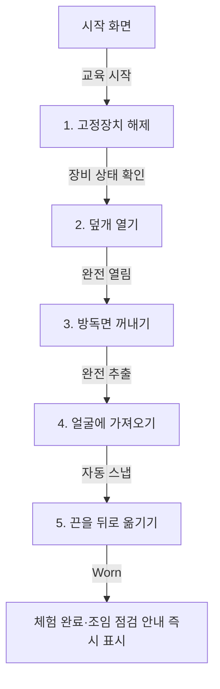

# 2026-10-28 K1 교육 단계·UI 설계

최신 상태(2026-10-28): 교육 5단계·안내 UI·공식자료 기반 완료 안내와 다시하기가 구현됐다. 사용자가 기능 확인과 다시하기 검증 완료를 보고했다. 교육 UI는 `db38038`, 다시하기는 `692f916`에 커밋됐다. [오늘 마감 기록](1028_작업마감_진행상황.md)을 우선한다.

구현 상세는 [1028_K1_교육단계_UI_구현기록.md](1028_K1_교육단계_UI_구현기록.md)를 따른다. 아래 설계 본문의 ‘미구현·실행 확인 전·다시하기 후속’ 표현은 설계 당시 이력이다. 현재 씬에는 다시하기까지 반영됐으며, 메뉴 5 재실행은 이전 구성의 씬을 갱신할 때 필요한 절차다. Quest 2 + Link 실기 성공은 별도 보고되지 않았다.

## 1. 목표와 범위

확인된 K1 장비 조작을 처음 사용하는 교육생이 안내에 따라 수행하도록 연결한다.

- 기존 주머니 → 추출 → 얼굴 자동 스냅 → 끈을 뒤로 이동 → `Worn` 조작을 유지한다.
- 교육생은 장비를 조작하면 자동으로 다음 안내를 받는다. 단계마다 확인 버튼을 누르지 않는다.
- 끈 조임·점검은 안내만 제공한다. 조작·합격 판정을 추가하지 않는다.
- 사용자 정정: 4단계의 표시 문구에서 `자동으로 붙습니다.`를 제거한다. `Worn` 도달 시 완료 화면과 조임·점검 안내를 함께 즉시 표시하고, 안내 확인 입력을 받지 않는다.
- 이번 과정은 안내 실습이다. 점수·합격 등급·제한시간·음성·평가 모드는 넣지 않는다.
- UI 연결과 장비 초기화는 별도 작업이다. 이번 기본 화면에는 아직 기능이 없는 다시하기·메뉴 복귀 버튼을 표시하지 않는다.
- 후속 다시하기 구현 시 동일 씬에서 장비·교육·UI를 함께 초기화한다. 현재 Runner의 StartTraining만으로 장비가 복원되는 것은 아니다.

## 2. 전체 흐름



교육 실습은 5단계로 표시한다. 기존 6번 조임·점검 안내는 완료 화면의 내용이며 별도 대기 단계가 아니다. 시작 화면과 완료 화면은 단계 수에 넣지 않는다.

## 3. 화면과 교육 단계

아래 문구는 UI 초안이다. 마지막 조임·점검 안내는 사용자 요청에 따라 국방홍보원 국방일보의 공식 원문 「방독면 원리와 착용」(2020-10-21)을 직접 확인해 요약했다. 정식 교본 또는 현행 개정 교범 확인으로 표현하지 않는다. 출처·확인 범위·최신 안내안은 [조임·점검 공식자료 검토](1028_K1_조임점검_공식자료_검토.md)를 따른다. 실제 코드의 완료 문구에는 아직 반영하지 않았다.

| 화면/단계 | 표시 문구 초안 | 교육생 행동 | 전환 기준 | 강조 대상 |
|---|---|---|---|---|
| 시작 | 제목: K1 방독면 착용 교육 / 설명: 주머니를 열고 방독면을 꺼내 착용하는 조작을 연습합니다. | `교육 시작` 버튼 | 새 시작 입력 1회 | 시작 버튼 |
| 1/5 고정장치 해제 | 주머니의 고정장치를 잡아 해제하세요. | 고정장치 조작점 선택 | 해제 확인 | 고정장치 |
| 2/5 덮개 열기 | 잡기를 놓은 뒤 덮개 손잡이를 잡아 끝까지 여세요. | 덮개 조작점 잡고 열기 | 완전 열림 확인 | 덮개 손잡이 |
| 3/5 방독면 꺼내기 | 방독면 본체를 잡고 위로 완전히 꺼내세요. | 위쪽으로 추출 | 완전 이탈 확인 | 본체 잡기 위치·위쪽 방향 |
| 4/5 얼굴에 가져오기 | 방독면을 얼굴 가까이 가져오세요. | 얼굴 근접 이동 | 얼굴 고정 시작 확인 | 얼굴 방향을 알리는 간단한 표시 |
| 5/5 끈을 뒤로 옮기기 | 본체는 놓아도 됩니다. 끈 하나를 잡아 대략 머리 뒤로 옮기세요. | 한 손으로 끈 뒤쪽 이동 | `IsWorn=true` 확인 | 좌우 끈 조작점 |
| 완료·조임 점검 안내 | 머리끈은 윗끈·아랫머리끈·중간끈 순으로 번갈아 당겨 조절합니다. / 조절 후 충분히 숨을 내쉬고, 정화통 흡입구를 손바닥으로 가린 채 숨을 들이쉬어 밀착 상태를 확인합니다. | 추가 조작 불필요 | `Worn` 확인 시 즉시 표시하고 유지 | 완료 제목·안내 본문·공식자료 출처 |

- 5단계 초기에 자동 정렬·머리끈 준비 중이면 짧게 `착용 준비 중입니다.`를 보여 준다. 준비가 끝나면 끈 조작 안내로 바꾼다.
- 준비 여부는 장비가 관리하는 실제 상태를 읽는다. UI에서 별도 0.3초 타이머로 완료를 추정하지 않는다. 필요한 준비 상태가 비공개라면 최소한의 읽기 전용 제공만 검토한다.
- 뒤쪽 목표를 보려고 고개를 돌리게 하지 않는다. 앞의 안내와 끈 조작점만으로 동작을 알 수 있게 한다.
- 수동 펼침은 선택 조작이다. 교육 단계·통과 조건에 넣지 않는다.

## 4. UI 구성

### 공통 안내판

한 개의 World Space 안내판에서 시작·진행·완료 내용을 교체한다. 완료 화면 안에 조임·점검 안내를 함께 표시한다. 단계마다 창을 추가로 띄우지 않는다.

진행 화면 구성:

```text
┌───────────────────────────────────┐
│ K1 방독면 착용 교육           3 / 5 │
│ ● ● ◉ ○ ○                         │
│                                   │
│ 방독면 꺼내기                     │
│                                   │
│ 방독면 본체를 잡고                 │
│ 위로 완전히 꺼내세요.             │
│                                   │
│ [필요할 때만 짧은 보조 안내]       │
└───────────────────────────────────┘
```

- 상단: 과정명·현재 단계/전체 단계. 진행 표시는 5개 점 또는 짧은 구간으로 표시하며 클릭할 수 없다.
- 중앙: 현재 단계 제목과 한 번에 수행할 행동. 본문은 가능한 2~3줄로 제한한다.
- 하단: 잘못된 조작이나 준비 중일 때만 보조 문구를 표시한다. 정상 시 빈 공간으로 둔다.
- 이번 화면의 조작 버튼은 시작 화면의 `교육 시작` 하나다. 완료 안내에는 확인 버튼이나 자동 닫힘 타이머를 넣지 않는다.
- 완료 화면은 `착용 동작 완료`와 `조임·점검 안내`를 함께 표시한다. 읽음 확인이나 실제 조임·점검 수행을 기록하지 않으며, `밀착 검사 통과`·`조임 완료`라고 표시하지 않는다.
- 마지막 안내는 공식자료에 근거한 구체적인 조임·밀착 확인 설명으로 표시한다. 완료 제목은 기존대로 유지하고 본문과 구분해 출처를 적는다. 길어진 본문과 출처가 한 화면 안에서 잘리지 않도록 여유를 확보한다.
- 결과 화면에 점수·시간·의학적 또는 보호 성능 합격 표시를 만들지 않는다.

### 배치와 읽기

- 작업대 앞에서 안내판과 장비를 함께 볼 수 있도록 안내판을 작업대 위쪽·약간 옆에 둔다. 주머니와 손 이동 경로를 가리지 않는다.
- 안내판은 월드에 고정한다. 매 프레임 카메라에 붙어 따라오게 하지 않는다.
- 시작 화면과 조임·점검 안내/완료 화면에 들어갈 때는 현재 시야 앞을 기준으로 배치를 조정할 수 있다. 조작 중에는 판이 움직이지 않는다.
- 초안 크기: 가로 약 0.7m·세로 약 0.4m, 읽는 거리 약 1.2~1.5m. 안내 화면은 긴 본문에 맞게 세로 여유를 확보한다. 수치는 조작 확인용 초기안이다.
- 글자는 기존 B의 한글 TMP 폰트를 재사용한다. 현재 안내를 읽기 위해 고개를 가까이 들이밀거나 스크롤할 필요가 없어야 한다.
- 어두운 불투명 배경·밝은 본문·강조색 한 종류를 기본으로 한다. 색과 함께 제목·진행 숫자·표시 형태를 사용한다.
- 장비 강조는 모델 재질 전체를 바꾸기보다 B 소유의 작은 표식·테두리·방향 표시를 우선한다. 이전 대상 강조는 단계 전환 시 끈다.
- 시야 밖이나 뒤통수에 안내를 두지 않는다. 완료 안내는 손 조작 없이 앞쪽에서 편하게 읽을 수 있어야 한다.

## 5. 입력과 진행 규칙

### 시작 버튼

- 시작 전에는 교육 대상 장비 선택을 잠그고 UI만 조작한다. 시작 후 장비 입력을 허용한다.
- 입력 잠금은 Runner·장비 전체 GameObject를 꺼서 해결하지 않는다. 필요한 선택 입력만 제한하고 기존 상태·참조를 보존한다.
- UI는 기존 XRI 레이 기반 조작을 사용한다. 교육생 안내에 키보드 `G`·`T`를 표시하지 않는다. Simulator 키 설명은 개발용 확인 절차에만 둔다.
- 시작 버튼 입력과 장비 조작이 중복 처리되지 않게 한다. 공용 XR 프리팹·패키지를 변경하지 않고 B 범위에서 연결한다.
- 버튼 연타·누른 채 화면 전환으로 시작이 중복 처리되지 않는다. 완료 시에는 별도 입력을 기다리지 않는다.

### 빠른 조작·되돌림

- 학습 편의를 위해 이미 확인한 단계를 계속 되풀이시키지 않는다. 안내를 기다리지 않고 빠르게 연속 조작해도 다음 단계가 멈추지 않아야 한다.
- 교육 실행 중 확인한 해제·완전 열림·완전 추출·얼굴 부착·착용 완료는 해당 회차의 달성 사실로 기록한다.
- 단순 이벤트만 듣고 다음 단계의 이벤트를 놓치지 않도록, 구독과 현재 상태 동기화를 시작 시 함께 준비한다. 다음 단계 진입 시 이미 달성한 사실도 읽는다.
- 덮개를 다시 닫았으면 꺼내기 안내의 보조 문구를 `덮개를 다시 끝까지 여세요.`로 바꾼다. 이미 수행한 해제·열기 교육을 실패로 되돌리지는 않는다. 실제 꺼내기 허용은 기존 장비가 결정한다.
- 끈 착용 전 명시적으로 방독면을 해제하면 5단계에서 `방독면을 다시 얼굴에 가져오세요.`로 안내한다. 다시 붙으면 끈 안내로 복귀하며 앞 단계 전체를 다시 하지 않는다.
- `Worn`을 확인한 뒤에는 교육 결과를 취소하지 않는다. 완료 후에도 기존 명시적 해제 조작은 사용할 수 있다.
- 실제 필요한 손 또는 머리 추적이 없어 동작이 멈췄을 때만 짧은 상태 안내를 표시한다. 추적 복귀 후 현재 단계에서 이어가고 실패·감점을 만들지 않는다.
- 조임·점검 안내는 화면 표시만 수행한다. 표시됐다는 사실을 읽음 확인이나 실제 조임·점검 수행 사실로 취급하지 않는다.

## 6. 기존 코드와 연결하는 설계

### 교육 진행

기존 `Assets/B/Scripts/Training`의 `TrainingRunner`·`TrainingDefinition`·`SceneBindings`·`TrainingTarget`을 재사용한다. 공통 Runner에 K1 전용 분기를 추가하지 않는다.

현재 Runner는 완료 조건 판정과 단계/완료 이벤트를 제공한다. UI·음성·장비 복원 기능까지 구현돼 있다고 가정하지 않는다.

K1 연결 계층은 다음 두 역할로 작게 나눈다. 이름은 설계상 가칭이다.

| 구성 | 책임 |
|---|---|
| K1 교육 연결부 | 기존 장비 상태·이벤트를 구독하고 현재 회차의 달성 사실을 TrainingTarget에 반영. 시작 전 입력 허용 여부 연결 |
| K1 안내 표시부 | 단계 ID에 맞는 제목·안내·강조 대상을 표시. 시작 버튼은 Runner 시작, 완료 시에는 조임·점검 안내를 즉시 표시 |

장비 컴포넌트는 교육 단계나 UI를 직접 바꾸지 않는다. UI도 장비의 추출·착용 상태를 강제로 변경하지 않는다.

### 판정 연결

| 단계 ID 초안 | 기존 근거 | 교육 조건 |
|---|---|---|
| k1-release-closure | `K1CarrierLid.IsUnlocked`·`Unlocked` | 이번 회차 해제 확인 |
| k1-open-lid | `K1CarrierLid.IsFullyOpen`·`FullyOpenChanged` | 이번 회차 완전 열림 확인 |
| k1-extract-mask | `K1MaskExtraction.IsExtracted`·`Extracted` | 완전 추출 확인 |
| k1-bring-to-face | `K1MaskWear.ControlsBody`·`StateChanged` | 이번 회차 얼굴 고정 확인 |
| k1-seat-straps | `K1MaskWear.IsWorn`·`Worn` | 이번 회차 착용 완료 확인 |

교육 데이터에는 위 실습 5단계만 둔다. 조임·점검 안내용 완료 조건이나 가짜 확인 행동을 만들지 않는다. 마지막 단계의 착용 달성을 확인하면 Runner의 정상 완료 처리와 함께 완료 안내를 표시하며, 별도 대기·타이머를 추가하지 않는다.

- 장비 달성 사실은 이번 실행의 작은 상태로 보관하고, 장비의 실제 동작은 기존 컴포넌트가 계속 소유한다.
- 새 교육 데이터에는 단계 ID·조건 ID만 둔다. UI 문구를 Inspector나 교육 에셋에 복제하지 않는다.
- 안내 문구는 K1 이름공간의 전용 `TrainingSubtitles` static class 상수로 관리한다. AED 문구·상태 흐름에 K1 분기를 섞지 않는다.
- 기존 AED의 폰트·패널 구성·버튼 연결 방식을 참고하되, AED 상태 제어기를 복사해 K1 기능을 덧붙이지 않는다.
- 기존 Runner는 프레임 종료에 단계 하나씩 전환한다. UI 때문에 재귀 전환이나 임의 지연을 추가하지 않는다.
- 과거 실행/단계의 늦은 장비 보고가 새 실행을 진행시키지 않도록 기존 실행·단계 토큰 규칙을 따른다.

## 7. 작업 구분

1. K1 장비 상태와 공통 교육 5단계를 연결한다. 빠른 연속 조작과 재부착 시 안내 복구를 확인한다.
2. 시작·진행·완료 화면과 한글 문구를 연결한다. 완료 화면에는 조임·점검 안내를 함께 표시한다. 장비 강조와 시작 버튼 입력을 확인한다.
3. 안내 위치·글자 크기·끈 조작점 표시를 조정한다.
4. 후속 별도 작업으로 다시하기와 장비 초기화를 연결한다. 메뉴 복귀는 팀 공통 목적지가 정해진 뒤 다룬다. 음성은 보류 상태를 유지한다.

## 8. 사용자 확인 기준

- 시작 전 장비를 임의로 진행할 수 없고 시작 버튼 1회로 교육이 시작된다.
- 단계마다 실제 행동에 맞는 안내와 강조 대상이 표시된다. 별도 다음 버튼은 필요 없다.
- 빠르게 열기·꺼내기·착용해도 이벤트 누락으로 교육이 멈추지 않는다.
- 펼침 없이 얼굴 스냅·손 놓기·뒤쪽 착용이 기존대로 동작한다.
- 덮개 닫힘, 착용 전 해제, 안착 중 중단·재개 시 필요한 안내로 복구된다.
- `Worn` 도달 시 완료 화면과 조임·점검 안내가 별도 입력·추가 대기 없이 표시된다.
- 안내에 확인 버튼·자동 닫힘이 없고, 실제 조임·점검 통과나 읽음 확인으로 기록되지 않는다.
- 4단계의 안내는 `방독면을 얼굴 가까이 가져오세요.`이며 자동 부착 설명을 덧붙이지 않는다.
- 시작 버튼 입력이 장비 조작으로 중복 처리되지 않는다.
- 한글 누락·잘림·필수 본문 스크롤이 없고 주머니·손·시야를 가리지 않는다.
- 완료 화면은 한 번만 표시되고 완료 이후 새 장비 조작이 결과를 다시 발생시키지 않는다.

실행 확인은 사용자 담당이다. 이번 설계 작성에서는 Unity·Simulator·테스트·빌드를 실행하지 않았다.
