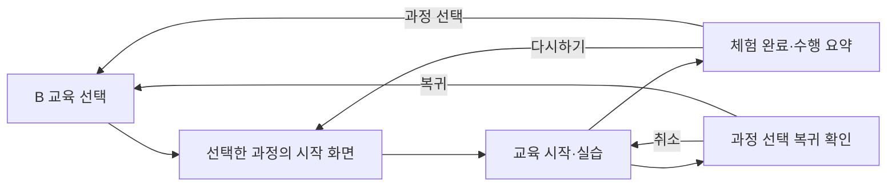

# 2026-10-29 출혈 처치 교육·과정 통합 설계

작성: B · 2026-10-29 (Asia/Seoul). 마감 상태: **설계 승인 후 지혈대 1챕터 구현·사용자 기능 확인·커밋 완료. 완성 모델 교체·2챕터 코드 및 후속 4건 수정은 정적 재검토 완료, 최신 실행 확인 전. 직접 압박·압박붕대와 과정 통합은 설계 상태다.** 현재 재개 기준은 [10/29 마감](1029_작업마감_진행상황.md)을 따른다.

> 아래 단계표는 최초 과정 설계다. 현재 2챕터의 가상 조작 순서는 부착 → 밴드 준비 → 막대 회전·고정 → 시간 기록 → 마감 → Done이다. 마감 후 패치가 가려지는 모델 구조를 고려한 순서이며 의료 절차 확정이 아니다. Runner·교육 시작/완료 UI·최종 재확인·다시하기 UI는 3챕터 연결 대상으로 남았다. 상세 상태·조건은 [모델 교체·2챕터 기록](1029_지혈대_모델교체_2챕터_구현기록.md) §9를 우선한다.

## 1. 결정과 기준

- 사용자 동의 순서: **지혈대 → 직접 압박·압박붕대 → 교육 선택·복귀 통합**.
- 이번 설계에서 제독은 제외한다. 보호의·CPR·무안내 평가·점수·결과 저장·음성은 추가하지 않는다.
- 10/29 사용자 보고: 기존 기능은 시뮬레이션으로 확인했으며 실기 확인은 추후 진행한다. 장치별·항목별 통과를 이 보고에서 추정하지 않는다.
- AED 한 사이클·다시하기, K1 착용·교육 UI·거울·다시하기는 완료 상태를 유지한다. K1 Worn 후 끈 풀림과 AED 음성은 기존 보류를 유지한다.
- 이번 산출물은 교육 흐름·VR 조작·상태·자산·통합·사용자 확인 기준이다. 코드 구현 프롬프트가 아니며 코드·씬·Prefab·설정은 변경하지 않는다.

## 2. 교육 범위와 자료의 경계

첫 버전은 안전이 확보된 훈련 공간에서 **다른 사람 역할의 고정된 교육용 인체 한 명, 접근 가능한 사지의 상처 한 곳, 두 컨트롤러**를 사용한다. 전투 중 사격·이동·자가 처치·다발 손상·생리학적 악화는 포함하지 않는다.

두 과정은 별도 상황이다. 모든 출혈에 지혈대와 붕대를 차례로 적용하는 하나의 처치 흐름으로 만들지 않는다. 상황별 장비 선택·위치·임상적 재평가 기준은 적용 교안에 맞춰 작성한다.

ACS STOP THE BLEED 교육 소개는 직접 압박·상처 패킹·지혈대 적용을 구분해 다룬다[S1]. 이는 콘텐츠 구분의 참고이며 한국 예비군 교안의 승인이나 전체 교육과정 이수를 뜻하지 않는다. 이번 범위에 상처 패킹은 넣지 않는다.

| 항목 | 설계 결정 | 추가 확정이 필요한 내용 |
|---|---|---|
| 지혈대 형태 | 조임막대·밴드·고정부·시간 표기부가 있는 형식을 기준으로 VR 조작 설계 | 실제 사용할 제품·세대·교육용 모델, 해당 사용설명서 |
| 압박붕대 형태 | 상처 덮개·감는 부분·고정부를 분리한 제한 경로 방식 | 실제 제품과 여밈 방식, 압박봉 등 추가 부품 유무 |
| 적용 부위 | 교육용 인체의 앞에서 접근 가능한 사지 한 곳 | 상처·관절 위치 및 교안상 허용 영역 |
| 의료 기준 | 임의의 거리·시간·회전 횟수·압력·합격선을 정하지 않음 | 부대 교안·교육 담당 검토로 처치 기준 확정 |
| VR 허용오차 | 배치 거리·방향·회전 진행량·접촉 확인 시간은 조작용 설정 | Simulator 조작감 확인 후 결정. 의료 수치와 별도 명명 |

JTS 공식 안내는 현행 TCCC 지침·권장 장비·교육 수준 자료로 연결한다[S2]. 이 설계에서 최신 지침 전문이나 국내 적용 교안을 확보·검토했다고 주장하지 않는다. C-A-T 제품은 형태 참고 후보이며 채택 확정이 아니다[S3]. 기존 검색의 NAR 사용설명서 다운로드 주소는 현재 홈페이지로 리디렉션되어 현행 IFU 전문 확보 근거로 사용하지 않았다.

실제 제품·교안 확정 전에도 배치·잡기·회전·복원 기술 시제품은 만들 수 있다. 이때 임시 허용 영역·진행량은 개발용으로 표시하며 의료적 정답 문구·배포용 처치 판정으로 사용하지 않는다.

## 3. 구현 순서와 각 단계의 완료 범위

| 순서 | 제작 단위 | 완료 기준 |
|---|---|---|
| 1 | 지혈대 장비 조작 | 잡기·가상 배치·밴드 정리·조임막대 회전·고정·초기화가 독립적으로 작동 |
| 2 | 지혈대 교육 한 과정 | 시작→실습→완료→다시하기→시작 대기. 단계·오류·결과 UI 포함 |
| 3 | 직접 압박·압박붕대 장비/교육 | 접촉 유지, 지정 경로 배치·고정, 별도 상황의 완료·다시하기 |
| 4 | B 교육 선택·복귀 | AED·K1·지혈대·압박붕대 진입, 완료·중단·재진입 연결 |

장비 조작을 먼저 확인하고 교육을 연결한다. 공통 프레임워크 확장을 선행 과제로 두지 않는다. 한 과정이 완결되면 사용자가 Simulator로 확인하고 다음 단위로 진행한다. 실기는 후속 일정이다.

## 4. 지혈대 교육

### 4.1 공간·입력

- 기존 B 마네킹의 작업본을 사용한다. 원본 FBX·AED 환자 Prefab은 수정하지 않는다. 선정 부위가 모델에서 가려지면 B 전용 자세·사지 모형으로 조정한다.
- 정면에 교육 대상, 한쪽에 장비 트레이, 반대쪽에 월드 고정 안내판을 둔다. 손 이동·상처 관찰 경로를 가리지 않는다.
- 한 손으로 장비 본체를 잡고 이동한다. 유효한 배치 미리보기에서 놓으면 사지 기준 앵커에 부착한다. Trigger를 스치는 것만으로 부착하지 않는다.
- 부착 후에는 본체를 이동시키는 XR 잡기를 종료하고, 밴드 끝·조임막대·고정부의 조작점으로 입력 대상을 나눈다.
- 어느 손으로도 조작 가능하다. 같은 막대를 두 손이 동시에 제어하지 않는다. 손을 바꿀 때 각도 기준을 다시 잡아 진행량이 튀지 않게 한다.

### 4.2 교육 단계표

아래는 **VR 화면·조작 단계**다. 실제 제품의 세부 사용 순서는 선정 제품의 설명서·교안으로 대조하여 확정한다.

| 단계 ID | 안내 목표 | 사용자 행동 | 완료 조건 |
|---|---|---|---|
| tq-identify | 훈련 상황·처치 부위 확인 | 제시된 상처 부위 선택 | 해당 회차의 올바른 대상 확인 |
| tq-select | 지정 장비 선택 | 트레이에서 지혈대 잡기 | 지정 장비를 실제 선택한 회차 기록 |
| tq-place | 허용 부위에 배치 | 위치·방향 미리보기 후 놓기 | 올바른 사지·허용 영역에 부착된 현재 상태 |
| tq-band | 밴드 정리 | 표시된 밴드 끝을 당겨 지정 고정부에 배치 | 밴드 경로·고정 상태 유효 |
| tq-turn | 조임막대 조작 | 선택한 막대를 축 주위로 회전 | 가상 조작 진행량 충족, 배치·밴드 상태 유효 |
| tq-secure | 막대·남은 부분 고정 | 고정부·마감부 조작 | 해당 제품에 필요한 고정 상태 모두 유효 |
| tq-record | 시간 표기·가상 상태 확인 | 표기부에서 현재 훈련 시각 기록 후 재확인 선택 | 기록 존재 및 배치·밴드·막대·고정의 현재 상태 재검사 통과 |

시작 화면에서 목표와 입력을 안내한다. 장비 조작은 시작 이후 허용한다. 단계별 다음 버튼은 두지 않는다. 마지막 재확인은 관찰·확인을 학습시키는 한 번의 행동이며, 버튼만 눌러 앞선 조건을 대신할 수 없다.

시간 기록은 현재 훈련 경과 시각을 표시하는 단순 조작으로 설계한다. 가상 키보드·현실 시간 오기 평가·합격 시간은 넣지 않는다. 표기 방식은 제품 선정 후 조정한다.

### 4.3 장비 상태·되돌림

가상 장비 상태는 미배치 → 배치 → 밴드 준비 → 회전 진행 → 고정 → 기록으로 구분한다. 이것은 임상 상태명이 아니다.

- 배치·밴드·고정은 **현재 상태**로 읽는다. 과거 한 번의 성공 이벤트만으로 최종 완료하지 않는다.
- 조임막대를 놓으면 마지막 가상 회전 상태를 유지한다. 고정 전에 손을 놓았다는 이유만으로 고정 완료를 기록하지 않는다.
- 유효 회전은 막대를 선택하고 손 추적이 유효한 동안만 축 기준으로 계산한다. 작은 손 떨림·축 가까이에서의 불안정한 각도는 진행으로 세지 않는다.
- 최초 유효 회전으로 가상 조임 방향을 정한다. 반대 방향은 가상 진행을 줄이고, 손을 다시 잡을 때 첫 프레임 각도 차이는 더하지 않는다. 정확한 제품 동작과 다르면 제품 확정 때 조정한다.
- 회전 각도는 실제 장력·압력·혈류 차단을 뜻하지 않는다. 장비 외형과 단계 진행을 위한 입력이다.
- 초기 배치가 틀리면 놓아도 부착하지 않고, 올바른 위치를 다시 찾게 한다. 부착된 장비를 첫 버전에서 자유롭게 분리·다시 조이는 기능은 넣지 않는다. 재배치가 필요하면 다시하기를 사용한다.
- 선행 상태가 유효하지 않으면 회전·고정·최종 완료를 막고 필요한 부위를 강조한다. Runner 단계를 강제로 과거로 돌리지 않는다.
- 상처 효과는 상태 설명용 시각화다. 회전량만으로 실제 지혈 성공·환자 회복·원위부 맥박 소실을 판정하거나 표시하지 않는다.

### 4.4 완료 화면

제목은 `지혈대 가상 조작 체험 완료`. 부위 확인·배치·밴드·막대 조작·고정·기록의 수행 여부를 표시한다. `실제 지혈 성공`·`술기 합격`은 표시하지 않는다. 다시하기 제공, 과정 선택 복귀는 통합 단계에서 연결한다.

## 5. 직접 압박·압박붕대 교육

### 5.1 시나리오와 조작 범위

지혈대 과정과 다른 훈련 상황을 사용한다. 지정 도구로 상처 부위를 덮고 접촉 유지 동작을 익힌 뒤, 제품에 맞는 붕대 배치·고정을 연습한다. 지혈대 실패의 자동 후속 처치로 연결하지 않는다.

한 손은 상처 덮개를 붙잡고 다른 손은 붕대 끝을 지정 경로로 옮기는 구성을 기본으로 한다. 자유로운 천 감기, 손가락 조작, 실제 압력, 깊은 상처 패킹은 제외한다. 붕대 제품 확정에 따라 실제 요구 동작을 다시 대조한다.

### 5.2 교육 단계표

| 단계 ID | 안내 목표 | 사용자 행동 | 완료 조건 |
|---|---|---|---|
| pb-identify | 훈련 상황·부위 확인 | 지정 상처 부위 선택 | 올바른 대상 확인 기록 |
| pb-select | 도구 준비 | 지정 덮개·붕대 선택 | 올바른 도구 선택 기록 |
| pb-cover | 상처 덮개 배치 | 덮개를 유효 위치·방향으로 가져오기 | 유효한 덮개 접촉 현재 상태 |
| pb-hold | 접촉 유지 동작 연습 | 덮개를 유지하며 표시된 조작 수행 | 유효 접촉·손 추적·선택이 연속 유지됨 |
| pb-wrap | 붕대 경로 배치 | 반대 손으로 붕대 끝을 순차 경로로 이동 | 지정 경로 순서·덮개 위치 유효 |
| pb-secure | 붕대 고정 | 제품에 맞는 마감 조작 | 덮개·경로·고정부 현재 상태 유효 |
| pb-check | 가상 상태 확인 | 상처 덮개·고정부를 보고 재확인 선택 | 현재 상태 재검사 통과 |

### 5.3 접촉·경로 판정

- `pb-hold`는 컨트롤러를 세게 누르거나 깊이 밀어 넣도록 요구하지 않는다. 가상 손/도구 위치·선택·추적 유효성만 읽는다.
- 접촉을 벗어나거나 도구를 놓거나 추적을 잃으면 연속 유지 시간이 0으로 돌아간다. 떨어진 여러 접촉을 합산하지 않는다.
- 이 시간은 **VR 입력 유지 확인 시간**이며 실제 권장 압박 시간으로 제시하지 않는다. 의료적 유지시간 조건은 교안 확정 전 비워 둔다. 관련 설정 미확정이면 교육용 정식 완료를 허용하지 않고 기술 시제품으로만 표시한다.
- `pb-hold` 달성은 해당 연습의 회차 기록이다. 이를 붕대를 감는 내내 실제 압박이 유지됐다는 증거로 쓰지 않는다. 직접 압박에서 붕대 고정으로 넘어가는 연속 처치의 유지·인계 조건은 교안·제품 확정 후 반영한다.
- 덮개를 유지한 손을 단순히 놓는 순간 자동 감기·자동 고정·출혈 멈춤을 표시하지 않는다. 시제품에서 직접 압박과 감기를 별도 연습 블록으로 구분할 수 있다.
- 경로는 사지 기준 순차 영역을 통과해야 한다. 끝점에 바로 갖다 대거나 한 영역에서 떨리는 동작으로 감기 완료하지 않는다.
- 추적이 끊기면 다음 경로 판정을 멈춘다. 복귀 후 현재 위치를 기준으로 재개하며 손 소실 구간의 이동은 통과로 계산하지 않는다.
- 감기 중 덮개가 허용 영역에서 벗어나면 진행을 멈추고 복구 안내한다. 유효한 위치 복구 후 미완료 경로부터 재개한다. 완료 시에는 현재 덮개·감긴 부분·고정부를 함께 확인한다.
- 시각적인 감김은 제한 경로·준비된 메시 변형으로 표현한다. 매 프레임 천 물리를 풀거나 사지 관통을 완료로 인정하지 않는다.

완료 제목은 `직접 압박·압박붕대 가상 조작 체험 완료`. 표시 항목은 부위·도구·접촉 유지 연습·경로·고정·재확인이다. 실제 압박력·지혈 효과의 합격 판정은 없다.

## 6. 공통 교육 구조와 실제 재사용 범위

10/29 읽기 전용 코드 확인 기준:

| 기존 구성 | 실제 상태 | 이번 설계 적용 |
|---|---|---|
| `TrainingDefinition` | 단계 ID와 Action/State/HoldState 조건 보유. 안내·Animation Action 데이터는 없음 | 신규 두 과정의 단계·조건 데이터에 사용. 옛 문서의 전체 Action 실행기가 구현됐다고 가정하지 않음 |
| `TrainingContext` | Idle/Running/Completed/Stopped, 조건 AND, HoldState 중단 시 0, 한 프레임 한 단계 전환 | 그대로 사용. 교육별 분기·임상 로직 추가 없음 |
| `TrainingTarget` | 현재 bool 상태와 행동 보고, 비활성 시 초기 상태로 재설정 | 장비 상태를 연결부가 갱신. 과정 중 잠깐 비활성화를 회차 저장 수단으로 쓰지 않음 |
| `TrainingRunner` | 시작·정지·단계 알림·완료. 장비 초기화·범용 결과 보고 없음 | 신규 과정 진행 담당. 초기화·요약은 과정 연결부 책임 |
| K1 교육 연결부 | 장비 상태→회차 기록, 입력 제한, 장비별 재설정 | 책임 구분을 참고. K1 장비 전용 코드를 복사·수정하지 않음 |
| AED 진행 | `AedTutorialStartController` 전용 상태 흐름 | 기존 동작 유지, 통합 시 외부 연결부만 추가 설계 |

신규 구조는 **장비 조작 → 과정별 연결부 → TrainingTarget → Runner**, 표시부는 단계·상태를 읽어 안내한다. 장비가 교육 UI를 직접 전환하거나 UI가 장비의 내부 상태를 강제로 완료시키지 않는다.

- 대상 확인·도구 선택처럼 되돌릴 필요 없는 경험은 Running 중 회차 기록으로 수집한다. 같은 프레임에 앞서 수행한 선택이 다음 단계 Action 구독 전에 발생해 누락되지 않게 한다.
- 배치·밴드·덮개·감김·고정은 현재 상태다. 최종 단계에 전체 필수 현재 상태와 재확인 행동을 함께 둔다.
- 현재 Runner는 단계 자동 되감기·임의 분기를 제공하지 않는다. 상태가 깨진 경우 장비가 복구 가능한 상태와 안내를 제공하고, 최종 완료는 차단한다.
- 지연 입력은 작업 시작 시 실행 회차·단계 토큰을 보유한다. 이전 회차의 보고를 현재 토큰으로 바꾸어 재사용하지 않는다.
- 모든 안내 문구는 해당 과정 이름공간의 `TrainingSubtitles` static class 상수로 관리한다. UI/Inspector/교육 데이터에 원문을 중복 저장하지 않는다.
- 공통 표시부는 실제 두 과정의 중복이 확인된 범위만 분리한다. AED·K1을 새 UI 틀로 전면 이전하지 않는다.

## 7. UI·오류 안내·다시하기

월드 고정 안내판 하나에 시작 / 현재 단계 / 완료를 교체한다. 기본 출력은 과정명·현재 단계·행동 한 가지·필요할 때 보조 안내다. 키보드 입력 안내는 교육생 화면에 넣지 않는다.

| 상황 | 표시·행동 |
|---|---|
| 틀린 대상·장비 | 짧은 오류 안내. 올바른 대상으로 다시 시도, 전체 초기화 없음 |
| 배치 불가 | 미리보기 불가 상태·이유 표시. 색만으로 구분하지 않음 |
| 조작점 선택 혼동 | 현재 조작점만 표식으로 강조. 본체·막대·밴드 선택 우선순위 명확화 |
| 선행 상태 불충족 | 필요한 장비 부위를 강조하고 완료 차단 |
| 추적 소실 | 입력 진행 정지, 복귀 뒤 새 기준. 성공으로 처리하지 않음 |
| 중간 다시하기 | `처음부터 다시 하시겠습니까?` 확인 후 초기화. 취소하면 기존 상태 유지 |
| 완료 | 수행 요약·다시하기. 통합 후 과정 선택 버튼 추가 |

신규 출혈 두 과정은 중간 다시하기를 제공한다. 이는 기존 AED·K1의 중간 다시하기 추가를 뜻하지 않는다. 공통 Runner에 Reset 기능이 있다고 가정하지 않는다.

초기화 순서: 새 입력 차단 → Runner 정지·이전 작업 무효화 → 실제 XRI 선택 종료 → 장비별 부모·배치·물리·잡기·밴드·회전·감김·고정·표기·상처 표시 복원 → 회차 기록·유지 시간·오류·강조 초기화 → 시작 화면.

초기화 후 자동 시작하지 않는다. XR Rig와 사용자의 현재 위치·시야는 동일 씬의 다시하기에서 유지한다. 초기화 실패 시 장비를 잠근 채 복구 안내를 표시하고 정상 시작 화면으로 위장하지 않는다.

## 8. 교육 선택·복귀 통합

### 8.1 첫 통합 범위

B 전용 교육 선택 씬에서 **AED / K1 / 지혈대 / 직접 압박·압박붕대** 네 과정으로 진입한다. 다른 팀원 씬·공용 메인 메뉴는 읽기 전용이며 이번 첫 통합 대상에 넣지 않는다. 팀 전체 진입점은 이후 계약을 맞춘다.

과정 선택은 로딩만 수행한다. 각 과정에 진입해 별도 교육 시작 입력을 받아야 한다. 구현되지 않은 과정은 진입 불가로 표시하며 버튼을 실제 구현보다 먼저 활성화하지 않는다.

### 8.2 씬·XR 소유권

- 기본안은 한 번에 콘텐츠 씬 하나를 여는 Single 전환이다. 각 씬의 기존 XR Rig를 사용하고 Rig를 영속화하지 않는다. 두 Rig·카메라·AudioListener·EventSystem이 동시에 작동하지 않게 한다.
- 씬 전환 때만 짧은 화면 가림과 도착 씬의 시작 위치를 사용한다. 다른 씬으로 이동하면서 이전 월드 좌표를 그대로 강제 복원하지 않는다. 같은 씬 다시하기의 위치 유지와 구분한다.
- 과정 전환을 조정하는 B 전용 소유자만 필요 최소한으로 유지한다. XR·장비·안내판·Runner를 함께 영속화하지 않는다. 씬마다 생성해도 조정자가 중복되지 않게 하고 직접 씬 실행도 지원한다.
- 목적지·로드 가능 여부를 확인한 후에만 진행을 정지한다. 전환 동안 입력을 잠그고 중복 로드를 막는다. 로드 실패 시 현재 씬을 보존하고 재시도 또는 해당 과정의 시작 상태 복구를 제공한다.
- 전환 전 대상 장비의 XRI 선택·진행 작업·안내를 정리한다. 새 씬은 이전 실행 이벤트를 받지 않는다. 목적지 시작 UI가 준비된 뒤 화면 가림을 해제한다.

### 8.3 과정별 연결 계약

아래는 **새로 구현할 책임**이며 기존 공통 API로 존재한다는 뜻이 아니다. 구체적인 C# 타입은 구현 설계 때 최소한으로 정한다.

| 책임 | 의미 |
|---|---|
| 시작 대기 준비 | 장비·안내를 초기 상태로 두되 교육을 자동 시작하지 않음 |
| 현재 결과 읽기 | 과정 ID·실행 ID·완료/중단·마지막 단계·수행 항목·오류 요약 |
| 복귀 준비 | 진행·새 입력 정지, XRI 선택과 과정별 대기·안내 정리 |
| 같은 과정 다시하기 | 해당 과정의 기존 또는 신규 초기화 경로 사용 |
| 종료 전달 | 같은 실행에 완료·중단 결과를 중복 송신하지 않음 |

- 과정 ID 초안: `b-aed`, `b-k1`, `b-tourniquet`, `b-pressure-bandage`. 기존 K1 TrainingId를 바꾸지 않고 외부 과정 ID와 연결한다.
- 결과는 현재 실행의 메모리 요약만 둔다. 영구 저장·서버·점수·합격 등급 없음. 기존 과정에서 수집하지 않은 세부 실수·단계는 `미수집`으로 표현한다.
- 완료 후 메뉴로 가면 Completed를 유지한다. 완료 전 복귀 확정이면 Aborted다. 단순 화면 전환으로 완료를 만들거나 완료 기록을 중단으로 덮어쓰지 않는다.
- AED의 최종 상태 `ShockDeliveredAwaitingNext=13`을 완료 관찰점으로 삼되 재시도·중단 상태와 구분한다. 기존 private 다시하기를 이미 외부 호출 가능한 공통 API처럼 사용하지 않는다. 필요 시 통합 단계에서 최소 공개 진입점을 별도 설계한다.
- K1은 Runner 완료와 기존 재설정 경로를 연결한다. 거울·아바타 조정값은 같은 씬 다시하기에서 유지한다. 씬을 나갔다 돌아올 때 런타임 조정의 자동 영속화는 첫 범위에 넣지 않는다.
- 직접 과정 씬을 실행했을 때도 단독 시작·다시하기는 유지한다. 허브 목적지가 실제로 준비되지 않았으면 복귀 버튼은 비활성하고 이유를 표시한다.
- 중간 복귀 확인창이 뜬 동안 새 조작·유지 시간 진행을 일시 정지한다. 취소하면 완료 사실·장비 상태는 보존하되 연속 유지 시간은 다시 시작한다. 이를 위한 일시정지 연결은 신규 작업이며 기존 Runner 지원으로 가정하지 않는다. 기존 AED·K1에도 적용할 때 각 진행 소유자의 입력·시간 정지 방식부터 확인한다.

### 8.4 프로젝트 외부 변경 의존성

10/29 파일 확인에서 `ProjectSettings/EditorBuildSettings.asset`에는 `Assets/Scenes/SampleScene.unity`만 등록돼 있었다. 배포용 씬 등록은 별도 필요하며 Build Profiles가 실제 빌드에서 사용하는 씬 목록도 구현 시 확인해야 한다. 에이전트는 실행·빌드하지 않는다.

B 선택 씬과 네 교육 씬 등록은 ProjectSettings/Build Profile 등 B 자산 경계 밖의 변경이 될 수 있다. 이번 설계에서 해당 파일을 바꾸지 않는다. 통합 구현 시 정확한 대상·변경 이유·방법을 정리하고 작업 규약에 따른 별도 승인을 받는다. 문서상 통합 동의가 공용 파일 변경 승인까지 뜻하지 않는다.

## 9. 자산·작업 경로 제안

아래 신규 경로는 제안이며 아직 생성하지 않았다.

| 분야 | 후보 경로·내용 |
|---|---|
| 지혈대 | `Assets/B/Models/Tourniquet/`, `Prefabs/Tourniquet_Training.prefab`, `Scripts/BleedingControl/Tourniquet/` |
| 압박붕대 | `Assets/B/Models/PressureBandage/`, `Prefabs/PressureBandage_Training.prefab`, `Scripts/BleedingControl/PressureBandage/` |
| 과정 연결·안내 | `Assets/B/Scripts/BleedingControl/Tutorial/`, 과정별 TrainingSubtitles |
| 교육 데이터 | `Assets/B/Data/Tourniquet_Training.asset`, `PressureBandage_Training.asset` |
| 씬 | `Assets/B/Scene/B_Tourniquet_Tutorial.unity`, `B_PressureBandage_Tutorial.unity`, `B_TrainingHub.unity` |
| 통합 연결 | `Assets/B/Scripts/TrainingHub/`, B 과정 선택 UI·과정별 연결부 |

모델 필수 요소:

- 지혈대: 고정 본체·버클, 변형 가능한 밴드, 밴드 끝 조작점, 축이 분명한 조임막대, 고정부, 마감부, 시간 표기면. 제품 확정 후 부품명·피벗을 고정한다.
- 붕대: 상처 덮개, 감는 부분, 조작 끝점, 제품별 고정부. 자유 천 대신 제한된 경로의 변형/단계 메시 사용.
- 인체 작업본: 상처 표시, 사지 기준 앵커, 허용/금지 영역, 단순 접촉 Collider. 시각 피부 메시와 판정 영역 분리.
- 안내: 기존 B 폰트·XR UI 방식을 참고. 기존 AED·K1 에셋을 직접 고치지 않고 새 과정에서 필요한 작업본 사용.

현재 B Models/Prefabs 파일 목록에서는 지혈대·압박붕대 전용 자산을 확인하지 못했다. 모델 확보·제작이 첫 선행 작업이다. 도구 모델의 사용 권한·원본 보존도 확인한다.

## 10. 사용자 Simulator 확인 기준

아래는 향후 사용자가 직접 실행할 순서다. 이번 설계의 정적 확인을 실행 통과로 기록하지 않는다.

| ID | 시작 상태·입력 | 기대 결과·실패 기준 |
|---|---|---|
| T01 | 지혈대 시작 전 장비 잡기, 시작 버튼 연타 | 시작 전 조작 잠금, 시작 1회. 중복 진행은 실패 |
| T02 | 틀린 사지·금지 영역에 배치 후 놓기 | 부착·다음 단계 없음, 수정 가능 |
| T03 | 올바른 위치에 놓고 밴드·막대 순서 조작 | 유효 상태에서만 진행. 닿기만 해서 성공하면 실패 |
| T04 | 막대 손 바꾸기·놓기·재잡기·역회전 | 기준 튐·무선택 누적 없음, 역회전 정책 일관 |
| T05 | 손 추적 소실 후 복귀 | 소실 구간 진행 없음, 원점 점프·복귀 순간 완료 없음 |
| T06 | 고정·기록 생략 후 재확인 | 최종 완료 차단, 부족한 항목 안내 |
| T07 | 빠르게 연속 조작 | 회차 기록 누락으로 멈추지 않음. 현재 상태가 잘못됐으면 완료 차단 |
| P01 | 덮개 접촉 중 이탈·놓기·추적 소실 | 연속 유지 시간 초기화. 잘못된 도구는 시작되지 않음 |
| P02 | 붕대 경로 건너뛰기·끝점 바로 이동 | 감기 완료 없음, 현재 다음 경로 안내 |
| P03 | 감기 중 덮개 이탈·복구 | 진행 중지→복구 후 재개, 잘못된 현재 상태에서 완료 없음 |
| R01 | 장비를 잡은 상태·회전 중·감기 중 다시하기 | 확인 후 선택 종료·초기화, 잔류 잡기·진행 없음 |
| R02 | 완료→다시하기→새 시작→완주 | 새 회차에서 모든 도구 재사용, 자동 시작·이전 성공 잔류 없음 |
| U01 | 각 단계·오류·완료 안내 확인 | 한글 누락·잘림·필수 스크롤 없음, 조작 경로 가림 없음 |
| H01 | 네 과정 각각 선택→시작 | 해당 시작 화면으로 진입, Rig·입력 UI 중복 없음 |
| H02 | 완료→메뉴→같은 과정 재진입 | 완료 전달 1회, 새 장비·시작 상태, 이전 콜백 없음 |
| H03 | 진행 중 메뉴 복귀 취소/확정 | 취소는 상태 보존·연속 유지 재시작, 확정은 Aborted 1회 |
| H04 | 복귀 버튼 연타·전환 실패 | 로드 중복 없음, 실패 안내·복구 가능 |
| H05 | AED·K1 기존 흐름·다시하기 | 기존 조작·완료·초기화 유지. K1 보류 문제를 수정 완료로 오인하지 않음 |

## 11. 다음 착수 단위

**완성 모델 교체·2챕터 최신 수정본의 사용자 실행 확인**부터 재개한다.

1챕터는 사용자 기능 확인을 받았다. Blender 모델 v1.1과 모델 교체·2챕터 코드가 작성됐고, 최신 4건 수정도 정적 재검토했다. 다음에는 사용자 임포트·컴파일 → 구성/검사 메뉴 → 모델·1챕터 회귀 및 [구현기록 §9.6](1029_지혈대_모델교체_2챕터_구현기록.md#96-사용자-직접-확인모두-미확인) ①~⑫의 결과를 반영한다. 실기는 사용자 지시대로 추후 진행한다.

그다음 3챕터에서 교육 Runner·시작/완료 UI·최종 재확인·다시하기 UI를 연결할 수 있다. 현재 `ResetToInitial()`은 장비 초기화 경로이며 교육 재시작 UI 완료를 뜻하지 않는다. 실제 제품·세대·IFU와 교안 확정은 별도 미완료다. 후속 직접 압박·압박붕대 → 과정 통합 순서는 유지하고 사용자 요청에 따라 구체화한다. 이 마감 갱신은 구현 착수나 프롬프트 자동 작성 지시가 아니다.

## 12. 근거·변경 범위

- 내부: [B 작업 규약](AGENTS.md), [실행계획](1021_B_구현범위_실행계획.md), [통합기획서](1020_B_구급법_화생방_통합기획서.md), [AED 마감](1023_작업마감_진행상황.md), [K1 마감](1028_작업마감_진행상황.md).
- 코드 읽기: `Assets/B/Scripts/Training/TrainingDefinition.cs`, `TrainingContext.cs`, `TrainingTarget.cs`, `TrainingRunner.cs`, K1 `K1TrainingLink.cs`, AED `AedTutorialStartController.cs`.
- [S1: ACS STOP THE BLEED — Get Trained](https://www.stopthebleed.org/get-trained/): 2026-10-29 열람, 교육에서 다루는 세 가지 행동 구분 확인. 압박붕대 제품의 사용법을 확보한 자료는 아님.
- [S2: JTS — TCCC Guidelines 안내](https://jts.health.mil/index.cfm/committees/cotccc/guidelines): 2026-10-29 열람, 현행 자료·장비·교육 수준의 공식 연결 경로 확인. 링크된 최신 전문 검토 완료는 아님.
- [S3: North American Rescue — C-A-T 제품](https://www.narescue.com/all-products/massive-hemorrhage/combat-application-tourniquet-c-a-t.html): 2026-10-29 열람, 장비 형태 참고 후보. 현행 IFU 확보·제품 채택 확정은 아님.
- 작성 전 기존 변경: `Assets/B/Fonts/NotoSansKR-Regular SDF.asset`, `Assets/B/Scene/B_K1_Tutorial.unity`. 그대로 보존한다.
- 이번 작업은 B 문서 작성만 수행. 코드·자산·설정 변경, Unity 실행·Simulator 조작·자동 테스트·빌드, 스테이징·커밋 없음.
